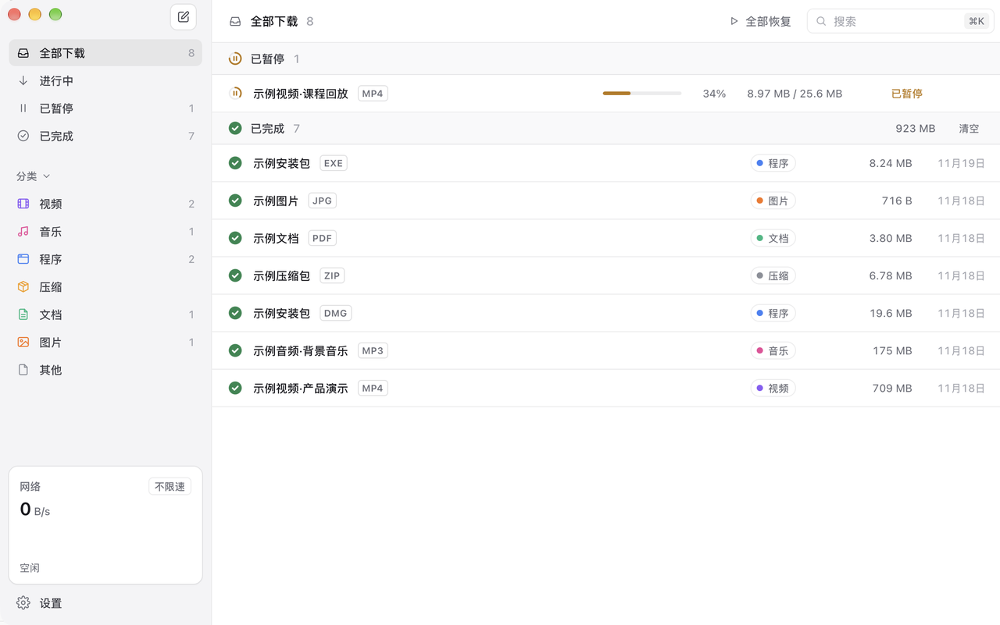
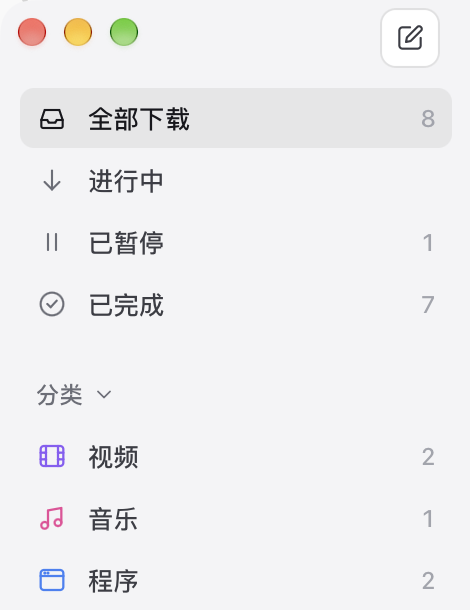

# SwiftDL 简体中文版 · 汉化说明

> 本项目是 **[harshsinghsv/swiftdl](https://github.com/harshsinghsv/swiftdl)** 的非官方简体中文汉化版。
> 原作者：**harshsinghsv**，上游采用 MIT 协议。本仓库保留其全部版权与许可声明，改动范围见 [NOTICE.md](NOTICE.md)。
> 需要英文原版或最新功能，请前往上游仓库。

上面就是汉化后的实际界面：左侧是下载分类，中间是下载列表，右下角显示当前网速。

---

## 这是什么

SwiftDL 是一个 IDM 风格的高速下载器，支持多连接分段下载、断点续传、浏览器接管下载、视频链接下载，
底层用 Rust + Tauri 写成，体积小、开销低。

这个版本在上游代码基础上做了**完整的界面汉化**，并按 macOS 的原生习惯调整了外观与文案。
下载引擎、协议实现、扩展逻辑都保持上游原样，没有改动核心行为。

## 汉化做了什么

### 一、界面全部中文化

侧栏、列表、按钮、对话框、右键菜单、命令面板、错误提示、设置页，全部中文。
系统菜单栏（文件 / 编辑 / 显示 / 窗口 / 帮助）也是中文。

### 二、贴合 macOS 的使用习惯

- 窗口用系统红绿灯按钮，侧栏是毛玻璃质感，与 Finder 一致的浅灰配色
- 快捷键提示统一用 `⌘` 写法（原来照搬了 Windows 的 `Ctrl`）
- 深色模式下保持原生灰（`#1a1b1f / #29292c`），不是简单的黑底反色

### 三、相对上游的功能与体验改动

| 改动 | 说明 |
| --- | --- |
| 侧栏增加「已暂停」 | 原来只有「进行中」和「已完成」，暂停的任务混在「进行中」里。现在分成 **全部下载 / 进行中 / 已暂停 / 已完成** 四类，「进行中」只留真正在跑的（下载中 + 排队中） |
| 分类「压缩文件」显示为「压缩」 | 只是界面显示更短，**存储值与下载子目录名没变**，历史记录不会错乱 |
| 去掉重复的搜索按钮 | 原来侧栏有一个放大镜、右上角有一个搜索框，点出来是同一个命令面板，删掉了侧栏那个 |
| 下载完成框点按钮后自动关闭 | 点「打开」或「在文件夹中显示」后窗口自己消失，不用再点一次「关闭」 |

### 四、修掉的两个上游 bug

1. **用这个软件下载时，点别的应用会"点不动"**：上游代码里有个每 0.8 秒执行一次的循环，只要下载窗口没焦点就把 SwiftDL 强制拉到前台。
   你点豆包、点 Finder，0.8 秒内焦点又被抢回去，那一次点击就丢了。现在改成只做两轮就收手。
2. **下载框第一次拖动会"回一跳"**：拖动过程中窗口还在自适应高度（`setSize`），原生拖动被打断，窗口跳回原位再跟手。
   现在拖动期间暂停尺寸自适应，松手后再补。

### 五、轻量化

- 窗口在后台（最小化、被别的应用盖住）时不再重绘界面，切回来补一次
- 空闲时不再每 0.5 秒重画一次空的速度曲线
- 拖动窗口边缘时不再每个像素都整页重排
- 删掉的下载会顺手清掉它的速度历史，长时间挂着不涨内存

---

## 界面说明

侧栏从上到下：

- **全部下载**：所有记录
- **进行中**：下载中 + 排队中
- **已暂停**：被暂停或中断的任务，点进去后右上角会变成「恢复全部」
- **已完成**：下载完的，右上角有「清空」（只从列表移除，文件保留）

下面是「分类」，按文件类型自动归到 视频 / 音乐 / 程序 / 压缩 / 文档 / 图片 / 其他，
数字是该分类下的条数。

列表里每条会显示：文件名、格式标签、所属分类、大小、时间。下载中的还会显示进度条、百分比、速度和连接数。

---

## 安装

1. 在 [Releases](../../releases/latest) 里下载 `SwiftDL-0.5.0-zh.1-macOS-arm64.dmg`（或 `.zip`）
2. 打开 dmg，把 **SwiftDL.app** 拖进「应用程序」（包里那个 `应用程序` 是一个指向 /Applications 的快捷方式）
3. 第一次打开如果提示「无法验证开发者」，去 **系统设置 → 隐私与安全性**，点「仍要打开」

程序会在菜单栏常驻一个小图标，关掉主窗口不会退出下载。想彻底退出，点菜单栏图标选「退出」。

## 浏览器扩展

扩展需要手动加载（macOS 会拦住程序自动注册）：

1. 打开 **设置 → 浏览器**，选择你用的浏览器（Chrome / Edge / Brave / Firefox），点「查看安装步骤」
2. 打开浏览器的扩展管理页，开启「开发者模式」
3. 点「加载已解压的扩展程序」，选程序目录里的 `extension` 文件夹（设置页有「打开扩展文件夹」按钮）
4. 回到 SwiftDL 设置页，浏览器状态变成已连接即可

装好后，在浏览器里点下载链接就会弹出 SwiftDL 的「新建下载」窗口。

## 快捷键

| 快捷键 | 作用 |
| --- | --- |
| `⌘N` | 新建下载 |
| `⌘K` | 打开搜索 / 命令面板 |
| `⌘,` | 打开设置 |
| `⌘↵` | 在新建下载窗口里开始下载 |

`Ctrl` 键的写法同样可用（程序里判断的是 Ctrl 或 Cmd 都行）。

## 卸载

- 直接用仓库里的 `卸载 SwiftDL.app`，或者
- 手动：把 `/Applications/SwiftDL.app` 拖进废纸篓，再删掉 `~/Library/Application Support/com.swiftdl.app/`
- 浏览器扩展在扩展管理页里移除

## 已知限制

- 底层的引擎级错误串（网络、解压等）仍保留英文，这些是上游原文，改动会影响排错
- 浏览器扩展不能在应用商店分发，只能手动加载
- 这是个人维护的**非官方**版本，上游更新需要手动合并；上游若有新功能，合并后我会补译新增文案

## 致谢

- 原作者 **[harshsinghsv](https://github.com/harshsinghsv/swiftdl)**：整个下载引擎、界面框架、浏览器扩展都是他的工作
- 上游项目采用 **MIT** 协议，本仓库据此进行汉化与本地化，版权归原作者及 SwiftDL contributors

## 使用提示

本项目是通用下载工具，请**只下载你有权获取的内容**，遵守当地法律与目标网站的服务条款。
程序本身不含任何 DRM 破解或绕过付费的功能。详见 [NOTICE.md](NOTICE.md)。
